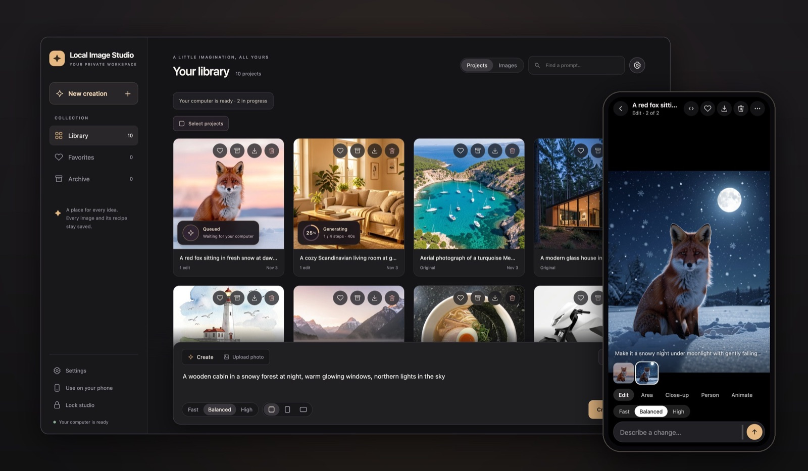
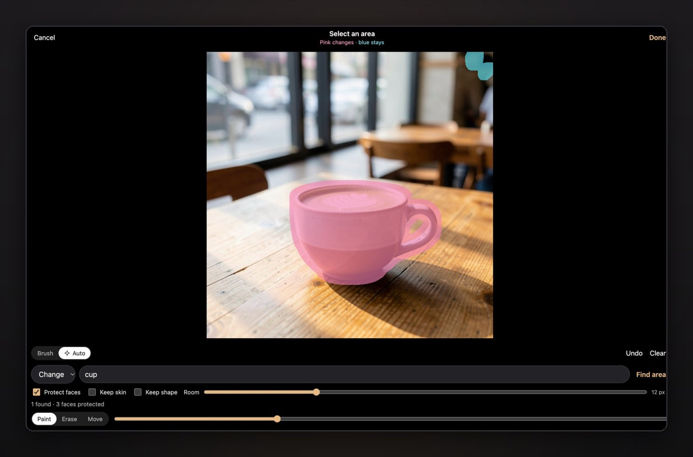

Every AI image tool I tried offered the same deal: upload your photos, accept someone else's rules, and pay every month. Local Image Studio is my answer to that. It's a complete image studio built on FLUX.2 Klein 9B, SAM 3 and ComfyUI, and everything runs on your own GPU. Your photos and prompts never leave your home network.

<figure class="blog-figure">
  
  <figcaption>Your library on the computer, and the same studio on your phone.</figcaption>
</figure>

You describe an image or a change in plain words, like "make it a snowy night", and it's made on your computer. Edits keep the photo's exact size and never touch the original. If only part of a photo should change, paint over it, or type a word like "cup" and SAM 3 finds it for you; every pixel outside stays exactly as it was. There are also close-ups, head and person swaps, and optional photo-to-video with LTX-2.3.

<figure class="blog-figure">
  
  <figcaption>Type "cup" and SAM 3 finds it: the pink area may change, everything else stays.</figcaption>
</figure>

The part I enjoyed most was making a 9-billion-parameter model behave on a 24 GB MacBook. Patching the MLX pipeline to release the text encoder and the transformer as soon as each one is done took a 1024 × 1024 image from 184 seconds to 76, with identical pixels. The model loads only when you make an image and unloads after ten idle minutes, so browsing your library never wakes the GPU. On Linux, the same studio runs on an NVIDIA GPU with as little as 6 GB of VRAM, natively or with Docker.

It's made for phones too: install it like an app over your home Wi-Fi, with HTTPS, share photos straight from your gallery, and browse your library offline when you're away.

On an Apple Silicon Mac it installs with one line in Terminal. The code is open source under Apache 2.0 and lives on [GitHub](https://github.com/aliarabbasi5155/local-image-studio). If you try it, I'd love to see what you make.
