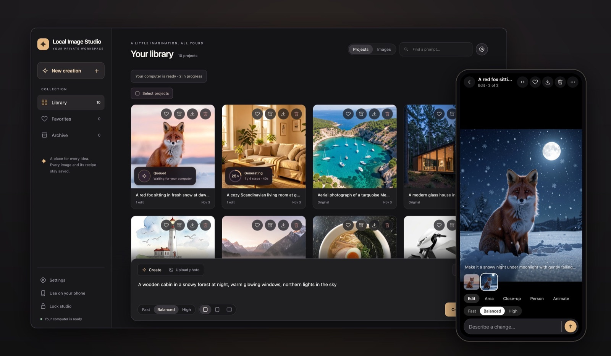
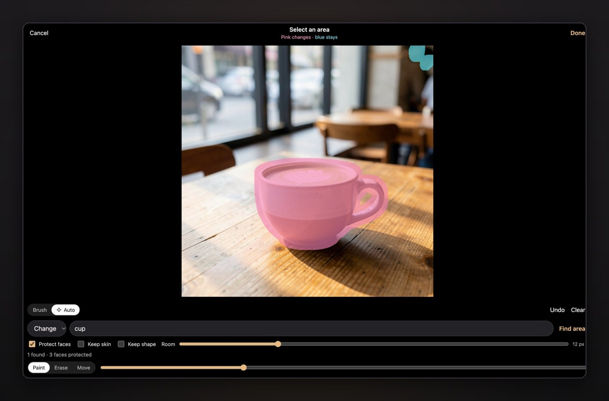

هر ابزار تصویرسازی با AI که امتحان کردم یه معامله‌ی ثابت جلوم می‌ذاشت: عکس‌هات رو upload کن، قوانین یکی دیگه رو قبول کن و هر ماه پول بده. Local Image Studio جواب من به این معامله‌ست؛ یه استودیوی کامل تصویر بر پایه‌ی FLUX.2 Klein 9B و SAM 3 و ComfyUI که همه‌چیش روی GPU خودتون اجرا می‌شه. عکس‌ها و promptهاتون هیچ‌وقت از شبکه‌ی خونه بیرون نمی‌رن.

<figure class="blog-figure">
  
  <figcaption>کتابخونه‌ی عکس‌ها روی کامپیوتر، و همون استودیو روی گوشی.</figcaption>
</figure>

عکس یا تغییری رو که می‌خواید با کلمه‌های ساده توصیف می‌کنید، مثلاً «make it a snowy night»، و نتیجه روی کامپیوتر خودتون ساخته می‌شه. ادیت‌ها اندازه‌ی دقیق عکس رو نگه می‌دارن و به عکس اصلی دست نمی‌زنن. اگه فقط یه بخش از عکس باید عوض بشه، با قلم‌مو روش رنگ کنید یا یه کلمه مثل cup بنویسید تا SAM 3 خودش پیداش کنه؛ هر pixelی که بیرون اون ناحیه‌ست دقیقاً همون‌جوری که بود می‌مونه. Close-up، جابه‌جا کردن سر یا کل یه آدم، و اگه بخواید ساختن ویدیو از عکس با LTX-2.3 هم توش هست.

<figure class="blog-figure">
  
  <figcaption>کافیه بنویسید cup تا SAM 3 پیداش کنه؛ ناحیه‌ی صورتی عوض می‌شه و بقیه دست‌نخورده می‌مونه.</figcaption>
</figure>

جذاب‌ترین بخش کار برای من این بود که یه مدل ۹ میلیارد پارامتری رو روی یه MacBook با ۲۴ گیگ حافظه رام کنم. با patch کردن pipeline مبتنی بر MLX، جوری که text encoder و بعدش transformer هر کدوم به‌محض اینکه کارشون تموم شد از حافظه آزاد بشن، زمان ساخت یه عکس ۱۰۲۴ × ۱۰۲۴ از ۱۸۴ ثانیه رسید به ۷۶ ثانیه، با pixelهای کاملاً یکسان. مدل فقط وقتی load می‌شه که دارید عکس می‌سازید و بعد از ده دقیقه بیکاری از حافظه می‌ره بیرون؛ برای همین گشتن توی کتابخونه‌ی عکس‌ها هیچ‌وقت GPU رو درگیر نمی‌کنه. روی Linux هم همین استودیو با یه GPU از NVIDIA و فقط ۶ گیگ VRAM اجرا می‌شه، مستقیم یا با Docker.

برای گوشی هم ساخته شده: می‌شه روی Wi-Fi خونه و با HTTPS مثل یه اپ نصبش کرد، عکس‌ها رو مستقیم از گالری براش فرستاد و وقتی بیرون از خونه‌اید، کتابخونه رو offline دید.

روی Macهای Apple Silicon با یه خط توی Terminal نصب می‌شه. کدش با لایسنس Apache 2.0 به‌صورت Open Source منتشر شده و روی [GitHub](https://github.com/aliarabbasi5155/local-image-studio) هست. اگه امتحانش کردید، خیلی دوست دارم ببینم چی می‌سازید.
