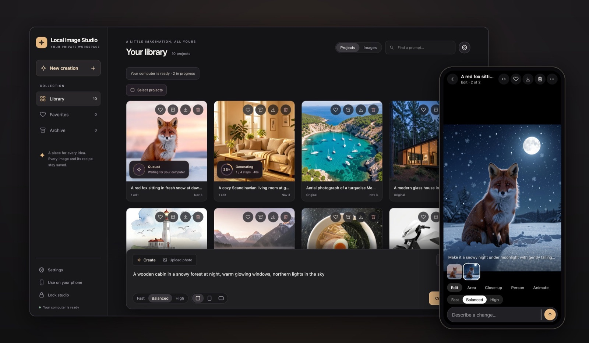
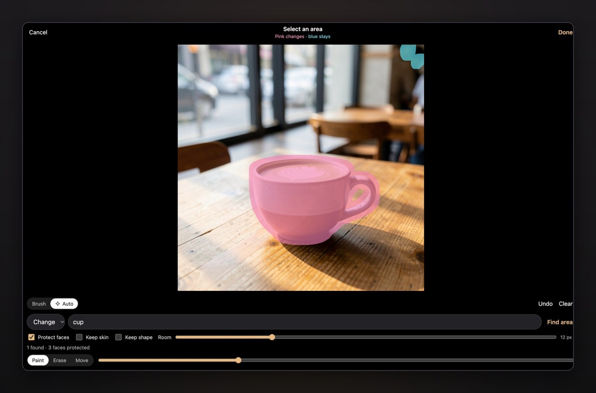

Ogni strumento di immagini AI che ho provato proponeva lo stesso patto: carica le tue foto, accetta le regole di qualcun altro e paga ogni mese. Local Image Studio è la mia risposta. È uno studio di immagini completo basato su FLUX.2 Klein 9B, SAM 3 e ComfyUI, e tutto gira sulla tua GPU. Le tue foto e i tuoi prompt non lasciano mai la rete di casa.

<figure class="blog-figure">
  
  <figcaption>La libreria sul computer e lo stesso studio sul telefono.</figcaption>
</figure>

Descrivi a parole un'immagine o una modifica, per esempio "make it a snowy night", e il risultato viene creato sul tuo computer. Le modifiche mantengono le dimensioni esatte della foto e non toccano mai l'originale. Se deve cambiare solo una parte, la dipingi col pennello oppure scrivi una parola come "cup" e SAM 3 la trova da solo; ogni pixel al di fuori resta esattamente com'era. Ci sono anche i close-up, la sostituzione della testa o di un'intera persona e, se vuoi, la trasformazione di una foto in video con LTX-2.3.

<figure class="blog-figure">
  
  <figcaption>Scrivi "cup" e SAM 3 la trova: la parte rosa può cambiare, il resto resta com'è.</figcaption>
</figure>

La parte che mi è piaciuta di più è stata far funzionare bene un modello da 9 miliardi di parametri su un MacBook con 24 GB di memoria. Modificando la pipeline MLX perché liberi il text encoder e il transformer appena ciascuno ha finito, un'immagine 1024 × 1024 è passata da 184 a 76 secondi, con pixel identici. Il modello si carica solo quando crei un'immagine e viene scaricato dopo dieci minuti di inattività, quindi sfogliare la libreria non sveglia mai la GPU. Su Linux lo stesso studio gira su una GPU NVIDIA con appena 6 GB di VRAM, direttamente o con Docker.

È pensato anche per il telefono: lo installi come un'app sul Wi-Fi di casa, con HTTPS, condividi le foto direttamente dalla galleria e sfogli la libreria offline quando sei fuori.

Su un Mac con Apple Silicon si installa con una sola riga nel Terminale. Il codice è open source con licenza Apache 2.0 e lo trovi su [GitHub](https://github.com/aliarabbasi5155/local-image-studio). Se lo provi, mi piacerebbe vedere cosa crei.
